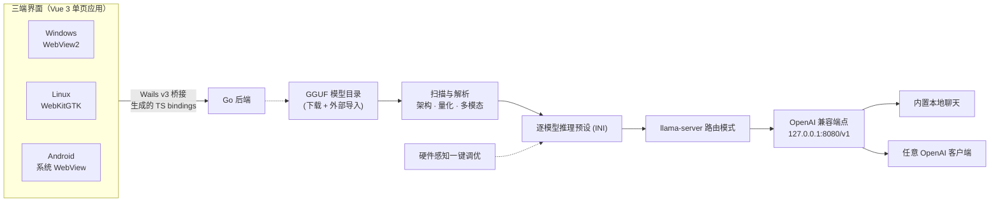

<div align="center">


# MyLlama（Android 可用性修复 fork）

**这个 fork 修的是那一件事：llama.cpp 明明下载并解压完了，应用却说「找不到 llama.cpp」——安卓上必然发生，macOS / Linux 上也会被 tar 里的软链接打断。**

它仍是同一套基于 [llama.cpp](https://github.com/ggml-org/llama.cpp) 的跨平台本地大模型客户端：扫描本地 GGUF → 可视化配置推理参数（或一键智能调优）→ 生成 llama-server 预设 → 一个 OpenAI 兼容端点供内置聊天与任意客户端使用；模型下载、本地聊天与实时监控都在应用内完成，数据不出本机。

**📥 本 fork 的安卓安装包：** [MyLlama-v0.6.0-android-arm64.apk](https://github.com/msln1995/MyLlama/releases/download/v0.6.0/MyLlama-v0.6.0-android-arm64.apk) ｜ [全部 Release](https://github.com/msln1995/MyLlama/releases)

**🍎 本 fork 的 macOS 安装包（universal，Apple 芯片与 Intel 通用）：** [MyLlama-v0.6.0-macos-universal.dmg](https://github.com/msln1995/MyLlama/releases/download/v0.6.0/MyLlama-v0.6.0-macos-universal.dmg) ｜ [zip 版](https://github.com/msln1995/MyLlama/releases/download/v0.6.0/MyLlama-v0.6.0-macos-universal.zip)（上游不发 macOS，这是本 fork 独有的产物）

包名是 `com.msln1995.myllama`，**与上游的 `com.codeneow.llamadesktop` 不同**：两个应用可以并存、互不覆盖，也不需要为了安装本 fork 而先卸载官方包。macOS 的 bundle id 同样用 `com.msln1995.myllama`。


Windows x64 · macOS universal · Android arm64 · Linux x64 · GPL-3.0

简体中文（本仓库） · [English](README_en.md) ｜ 原版与官方下载：跳转到 [CodeNeow/MyLlama](https://github.com/CodeNeow/MyLlama)

[](https://github.com/msln1995/MyLlama/actions)
[](https://github.com/msln1995/MyLlama/releases)
[](https://github.com/CodeNeow/MyLlama/pull/43)
[](LICENSE)
[](https://go.dev/dl/)
[](https://wails.io/)
[](https://vuejs.org/)

</div>

---

## 📌 我们改了什么

这个仓库是 [CodeNeow/MyLlama](https://github.com/CodeNeow/MyLlama) 的 fork。**上游不属于我们，官方 Release 也只由上游发布**——本页只写我们这一份的实际情况，想读原版说明请直接跳转上游仓库，不要在这里找。

我们只动了一条链路：**运行环境下载完之后，应用能不能真的认它**。修复已按 [PR #43](https://github.com/CodeNeow/MyLlama/pull/43) 提交上游评审，合并后这里的代码差异就会消失；包名（下面第 4 条）与 macOS 发行包（下面第 7 条）是本 fork 自己的决定，不会提交上游。

**v0.6.0 新增改动（基于真机实测的性能优化）：**

8. **Android 内存计价与守卫** — 启动前精确计算模型总 footprint（权重 + KV 缓存 + 上下文检查点 + 运行时开销），超预算直接拦截并给出可操作的上下文建议，不再闪退。KV 缓存按真实量化类型计价，守护与调参器共用同一公式。
9. **Android prompt cache 优化** — 50% 的 headroom 钳位在 ctx 16384 时让 replay 慢 5× 但不省内存，Android 端份额提升至 90%，prompt cache 命中时 replay 快 3-5×。
10. **Android 线程数修复** — 未调优模型默认 8 worker 与系统回收抢核导致卡顿；现在按性能核数封顶（4 线程），实测解码速度稳定在 3.4-3.9 tok/s。
11. **macOS Metal 支持** — Mac 端（Apple Silicon）走 Metal 后端，全 offload 时推理速度显著快于 CPU-only；内存计价按 Metal working set 而非系统 RAM。
12. **三选项外观模式** — 主题设置从「开/关」改为「跟随系统 / 浅色 / 深色」三选一，macOS 和 Android 均支持自动检测系统主题。
13. **自动语言检测修复** — macOS 通过 `defaults read -g AppleLanguages`、Android 通过 `getprop persist.sys.locale` 检测系统语言，不再始终回退到英文。
14. **更新指向 fork** — 应用内「检查更新」现在去本 fork 的 Release 页（`msln1995/MyLlama`）而非上游，设置页也加了说明提示这是独立分支。

1. **选包**：打分相同时上游按 GitHub API 的返回顺序取第一个，于是安卓 / Linux arm64 经常拿到 `*-snapdragon` 的 `cmake --install` 布局包——解压完目录里没有可执行文件位置对得上。`pickBestAssetFor` 现在给 `-snapdragon` 强降权（−400 分），普通平铺 CPU 包优先，实在没有别的可选时才回退。
2. **目录布局**：上游只在下载目录本身和它的一级子目录里平铺查找。`findLlamaBinInDir` 现在额外检查每个子目录下的 `bin/`（硬上限两层），`detectAccel` 与 CUDA runtime 探测同样遍历同级 `lib/`，于是 `release/bin/<binary>` 这种布局也能认。
3. **安卓启动**：安卓的链接器不会自动搜索可执行文件所在目录，只导出二进制自身目录不够。`androidLdEnv` 现在把同级 `lib/` 一起加进 `LD_LIBRARY_PATH`（冒号分隔）。
4. **包名独立**：`applicationId` / `namespace` 改成 `com.msln1995.myllama`（上游是 `com.codeneow.llamadesktop`）。这样本 fork 的 debug 签名包与官方正式包**互不冲突、可同时安装**，不再需要「先卸载才能装」；代价是两份数据目录彼此独立——配置、llama.cpp 运行时与模型都不互通，需要在本 fork 里重新下一遍。Java 源码仍留在 `com.wails.app`，因为 Wails v3 的 JNI 导出符号是按那个包名硬编码的。
5. **解压不再被软链接打断**：macOS / Linux 的 tar 包里 `llama-server` 排在软链接条目之后，上游遇到第一个 symlink 就中断，于是「已安装」和「找不到」同时成立。`archive.go` 改成两阶段物化：先落普通文件并收集链接条目，再统一创建 symlink / hardlink，失败时复制目标文件兜底；复制的字节也计入总量上限。
6. **解压加固**：链接目标必须留在解压目录内（沿用既有的路径穿越拒绝规则），并新增 `maxExtractTarLinks = 64` 上限。
7. **macOS 有了发行包**：上游只发 Windows / Ubuntu / Android 四个产物，**从来没有发过 macOS**，虽然代码侧对 darwin 的支持是完整的。本 fork 补了 `scripts/macos_package.sh`：交叉编译 arm64 + x86_64、`lipo` 成 universal 可执行文件、组装 `MyLlama.app`（Info.plist / PkgInfo / 由 `build/appicon.png` 生成的 AppIcon.icns）、adhoc 签名，产出 zip 与 dmg。走本地脚本而不是 CI 作业，是因为 macOS runner 的分钟数在公开仓库也要计费——是否值得加 `build-macos` CI 作业留给上游决定。

配套的针对性单测在 `core` 包里：用真实 b11671 资产名与 API 返回顺序做选包用例、两种目录布局的检测用例、symlink / hardlink 与链接数上限的解压用例。

## 🧭 大致有什么功能

- **运行环境自管**：在首页「运行环境」下载 llama.cpp 主程序与 CUDA runtime，支持断点续传，也可指向已有的 llama.cpp 目录。
- **模型管理**：扫描本地 GGUF 并读取真实元数据（层数、注意力头、KV 几何、训练上下文、MoE 专家占比），从 HF 镜像 / Hugging Face / ModelScope 搜索并下载模型。
- **一键智能调优**：结合硬件快照与实测内存带宽为每个模型规划推理参数；还有逐模型 llama-bench 实测验收，以及 n-gram 投机解码、q8_0 KV 量化、flash-attention 开关、多卡切分等性能细节。
- **一个 OpenAI 兼容端点**：生成 llama-server 预设并启动服务（默认 `127.0.0.1:8080`），桌面端是路由模式（懒加载、多模型共用一个端点），安卓是直连单模型模式。
- **内置聊天与监控**：聊天页发消息即自动拉起服务并按需换入所选模型；API 页有实时 token 速度与服务日志控制台。
- **本地优先**：无遥测、无云端依赖，断网可用；深浅主题、中英双语，手机档自动切底部导航并适配安全区。

## 📥 安卓安装

1. 下载 [MyLlama-v0.6.0-android-arm64.apk](https://github.com/msln1995/MyLlama/releases/download/v0.6.0/MyLlama-v0.6.0-android-arm64.apk)（arm64，Android 5.0+；[Releases 页](https://github.com/msln1995/MyLlama/releases) 有全部产物与说明）。
2. 点开安装，按提示允许「安装未知来源应用」。因为包名不同，**官方包装着也能直接装**，不用卸载。
3. 打开 App → 首页「运行环境」→ 下载 llama.cpp。现在拿到的是 `...-bin-android-arm64.tar.gz` 平铺包，装完应显示**已安装**（这就是本 fork 修的那一步）。
4. 模型目录自己指定或下载（llama.cpp 运行时放在应用私有目录，安卓沙箱不允许执行外部存储上的二进制，所以没有「手动把包放进去」这条路）。
5. 聊天页选模型直接发消息即可，服务会自动拉起。

## 🍎 macOS 安装

1. 下载 [MyLlama-v0.6.0-macos-universal.dmg](https://github.com/msln1995/MyLlama/releases/download/v0.6.0/MyLlama-v0.6.0-macos-universal.dmg)（universal：Apple 芯片与 Intel 同一个包，系统按原生 slice 执行；不想挂载 dmg 就用 [zip 版](https://github.com/msln1995/MyLlama/releases/download/v0.6.0/MyLlama-v0.6.0-macos-universal.zip)）。两个文件旁边各有同名 `.sha256`。
2. 挂载 dmg，把 `MyLlama.app` 拖进「应用程序」（zip 版就是把 `MyLlama.app` 拖到任意位置，别放在「下载」里）。
3. **第一次打开需要绕过 Gatekeeper**：产物只有 adhoc 签名、没有 Apple 公证（fork 拿不到 Developer ID），浏览器下载回来的副本带 `com.apple.quarantine`。所以在访达里**右键（按住 Control 点击）→ 打开 → 再点「打开」**；如果被直接拦掉，终端执行 `xattr -dr com.apple.quarantine /Applications/MyLlama.app`。之后的启动正常。
4. 打开 App → 首页「运行环境」→ 下载 llama.cpp。macOS 拿到的是 `...-bin-macos-arm64.tar.gz` 或 `-macos-x64.tar.gz`，都是平铺包；tar 里分别有 18 / 16 个软链接条目，`llama-server` 排在它们之后——**上游正是卡在这里，本 fork 修好了**（本页顶部第 5 条），装完应显示已安装。
5. 之后与桌面版一致：模型页下载或指向本地 GGUF，聊天页发消息自动拉起服务，或到 API 页手动启动 OpenAI 兼容端点。

环境要求 macOS 11 及以上。Apple 芯片走 Metal 加速；**Intel Mac 只有 CPU（BLAS）**——这是 llama.cpp 官方 x64 发行包本身的限制，`detectAccel` 已按架构分别处理，不是本 fork 引入的降级。数据目录在 `~/Library/Application Support/myllama`。

## ⚠️ 本 fork 独有的边界

- 安装包是 fork CI 产的 per-runner **debug keystore** 签名（fork 拿不到仓库 secrets）。因为包名独立，这只影响「同一个包内不能覆盖不同签名」这一条，与官方包和平共存；升级本 fork 时用相同签名（都来自 fork CI）正常覆盖安装即可。
- **应用内「检查更新」指向本 fork**（v0.6.0 起）：`core/update.go` 现在查询 `msln1995/MyLlama` 的 Release，而非上游。设置页有说明提示这是独立分支。
- App 内置教程（Docs 页）抓取的仍然是**上游 main** 的文档（`core/remotedocs.go` 的 `docsRawBaseURL` / `docsJSDBaseURL` 都写死了 CodeNeow/MyLlama），所以手机里看到的教程不含本页这些 fork 差异；本页 README 才是本 fork 的说明来源。
- macOS 产物由 `scripts/macos_package.sh` 在**本机**构建，不进 CI：只有 adhoc 签名、未经 Apple 公证（fork 没有 Developer ID，也用不了上游的证书），首次打开需要按上面第 3 步绕过 Gatekeeper；只有 CPU / Metal 功能路径在本机验证过，没有做跨机型矩阵测试。这条差异也不会随 PR #43 合并而消失——上游本来就没有 macOS 发行包，要不要加属于他们的决定。
- macOS 没有 App 内「检查更新」：`core/update.go` 的自更新只覆盖 Windows 与 Android，本页 Releases 是 macOS 唯一的更新来源。
- 两个已知缺口本次没动，也写进了 PR #43：`RuntimeSection.vue` 在状态为 `done` 时把两个入口都藏掉；`GetLlamaCpp` 的检测结果没有 TTL，也没有重新扫描的 binding。

---

## ✨ 为什么选择 MyLlama

<table>
<tr>
<td width="50%" valign="top">

**🔒 本地优先 · 隐私无忧**<br/>
模型、对话与推理数据全部留在本机：无遥测、无云端依赖，断网也能完整使用——数据去哪儿只由你决定。

</td>
<td width="50%" valign="top">

**🎯 一键智能调优**<br/>
读取 GGUF 真实指标（层数、注意力头、KV 几何、训练上下文、MoE 专家占比），结合硬件快照与实测内存带宽，为每个模型自动规划推理参数。

</td>
</tr>
<tr>
<td width="50%" valign="top">

**⚡ 推理性能细节**<br/>
n-gram 投机解码零额外显存、q8_0 KV 缓存量化撑起更长上下文、flash-attention 开关、多卡显存切分模式、Windows 全量 offload 启动钉定，逐模型 llama-bench 实测验收。

</td>
<td width="50%" valign="top">

**🖥️ 三端一体体验**<br/>
同一套 Go + Vue 3 代码覆盖 Windows / Linux / Android：手机档自动切换底部导航并适配安全区，深浅主题、中英双语界面与内置教程全端一致。

</td>
</tr>
<tr>
<td width="50%" valign="top">

**🔁 OpenAI 兼容生态**<br/>
llama-server 以路由模式运行，目录下所有 GGUF 汇聚成一个 OpenAI 兼容端点：模型按需懒加载、空闲一键卸载，任意 OpenAI 客户端即插即用。

</td>
<td width="50%" valign="top">

**📦 模型获取与管理**<br/>
HF 镜像 + ModelScope 双源搜索，批量下载走可断点续传的任务队列（重启自动恢复）；GGUF 元数据解析（架构 / 量化一览），支持外部导入目录。

</td>
</tr>
<tr>
<td width="50%" valign="top">

**📊 可视化监控**<br/>
提示处理 / 生成 tok/s 双指标与近 60 秒速度曲线，GPU、内存、CPU 实时采样，服务日志控制台按游标增量刷新、落盘不丢失。

</td>
<td width="50%" valign="top">

**💤 无头 API 模式**<br/>
（Windows）一个开关切换为纯后台运行（托盘 + llama-server）：GUI ↔ 后台零中断交接服务进程，回环控制面提供健康检查、状态、日志与停止接口。

</td>
</tr>
</table>

<details>
<summary><b>📖 目录</b></summary>

- [📌 我们改了什么](#-我们改了什么)
- [🧭 大致有什么功能](#-大致有什么功能)
- [📥 安卓安装](#-安卓安装)
- [🍎 macOS 安装](#-macos-安装)
- [⚠️ 本 fork 独有的边界](#-本-fork-独有的边界)
- [✨ 为什么选择 MyLlama](#-为什么选择-myllama)
- [🎨 界面与设计](#-界面与设计)
- [🚀 快速开始](#-快速开始)
  - [Windows](#windows) · [Android](#android) · [Linux](#linux) · [macOS](#macos)
  - [首次使用（三步上手）](#首次使用三步上手)
- [🧠 一键调优](#-一键调优)
- [🔌 API 接入](#-api-接入)
- [🔧 配置](#-配置)
- [🧱 架构](#-架构)
- [🔨 从源码构建](#-从源码构建)
- [❓ 常见问题](#-常见问题)
- [📄 协议与致谢](#-协议与致谢)

</details>

---

## 🎨 界面与设计

> 以下为 UI 设计稿的渲染图（桌面 1280×800、手机 390×844，浅色与深色双主题；设计源文件见 [docs/branding](docs/branding)），用于展示界面布局与视觉风格，实际界面以各平台发布版本为准。

**桌面端 · 浅色主题**

<table>
<tr>
<td width="50%" align="center">

<br/>
<i>首页 · 系统信息与快速开始</i>

</td>
<td width="50%" align="center">

<br/>
<i>本地聊天 · 流式对话与深度思考</i>

</td>
</tr>
<tr>
<td width="50%" align="center">

<br/>
<i>模型管理 · 下载与我的模型</i>

</td>
<td width="50%" align="center">

<br/>
<i>API 路由 · 服务控制与实时监控</i>

</td>
</tr>
</table>

**桌面端 · 深色主题**

<table>
<tr>
<td width="50%" align="center">

<br/>
<i>首页 · 系统信息（深色主题）</i>

</td>
<td width="50%" align="center">

<br/>
<i>本地聊天（深色主题）</i>

</td>
</tr>
<tr>
<td width="50%" align="center">

<br/>
<i>模型管理（深色主题）</i>

</td>
<td width="50%" align="center">

<br/>
<i>API 路由（深色主题）</i>

</td>
</tr>
</table>

**Android · 直连模式**

<table>
<tr>
<td width="33%" align="center">

<br/>
<i>主页</i>

</td>
<td width="33%" align="center">

<br/>
<i>聊天</i>

</td>
<td width="33%" align="center">

<br/>
<i>模型</i>

</td>
</tr>
<tr>
<td width="33%" align="center">

<br/>
<i>API 路由</i>

</td>
<td width="33%" align="center">

<br/>
<i>设置</i>

</td>
<td width="33%" align="center">

<br/>
<i>灵动任务卡片 · 悬浮任务胶囊</i>

</td>
</tr>
</table>

**各页面速览**

| 页面 | 用途 |
| --- | --- |
| **首页** | 「系统信息」自动检测 CPU / 内存 / GPU / CUDA 并实时采样（含 Blackwell 显卡兼容性判定）；「运行环境」一键下载 llama.cpp 或指定自定义目录，落地标签智能选择 |
| **聊天** | 流式本地对话：Markdown 渲染、可折叠思考过程、图片附件、生成预设（精准 / 均衡 / 创意 / 随机 + 自定义）与会话级采样参数；发送即自动拉起服务 |
| **模型** | 「下载」：HF 镜像 / Hugging Face / ModelScope 三源搜索 + 文件级断点续传队列；「我的模型」：扫描解析（架构 / 量化 / 多模态识别）、一键调优与逐模型参数设置 |
| **API** | 服务启停、tok/s 双指标与速度曲线、游标增量式服务日志、已加载模型管理与一键卸载；端口 / 最大并发 / Prompt 缓存配置 |
| **设置** | 主题 / 语言（zh · en · auto）/ 下载源 / 目录 / 服务访问范围与推理显卡 / Windows 托盘 / API 路由模式 / 检查更新；「帮助与教程」入口进入内置双语教程（在线更新） |

---

## 🚀 快速开始

### Windows

前往 [Releases 最新版](https://github.com/CodeNeow/MyLlama/releases/latest) 下载 `MyLlama-setup-*-windows-amd64.exe`，双击安装即可（安装包内嵌 WebView2 Runtime 引导器，系统缺失时自动安装）。应用内置自动更新，后续新版本无需手动重装。

环境要求：Windows 10 及以上（x64）。

### Android

本 fork 的安卓安装包见上文「📥 安卓安装」一节：从**本仓库**的 Releases 下载 `MyLlama-v0.6.0-android-arm64.apk`，包名 `com.msln1995.myllama` 与上游不同，因此和官方应用可以共存、直接装而无需先卸载。原版（`com.codeneow.llamadesktop`）请从 [CodeNeow/MyLlama Releases](https://github.com/CodeNeow/MyLlama/releases/latest) 获取。v0.6.0 起应用内「检查更新」已指向本 fork，可正常使用；fork CI 的 debug 签名之间也可以正常覆盖安装。

### Linux

Releases 提供 Ubuntu 22.04 / 24.04 的 `.deb` 包：下载 `myllama_*_amd64.deb` 后安装（`sudo apt install ./myllama_*_amd64.deb`），GTK / WebKit 运行库由包依赖自动解析。其他发行版可参考[从源码构建](#-从源码构建)。

### macOS

本 fork 提供 universal 的 macOS 发行包（上游没有）：见上文「🍎 macOS 安装」一节，从**本仓库** Releases 下载 `MyLlama-*-macos-universal.dmg` 或 zip，首次打开需要右键 → 打开来绕过 Gatekeeper。想自己构建也行，`scripts/macos_package.sh` 就是完整流程；只要手工编译一个可执行文件，`go build -tags production -o build/bin/MyLlama .` 在 darwin 上即可（Apple Silicon 走 Metal 加速，Intel 只有 CPU）。

### 首次使用（三步上手）

1. **装运行环境** — 在**首页**的「运行环境」标签点击「下载 llama.cpp」从 GitHub 获取最新版（支持断点续传），也可指定已有的 llama.cpp 目录。
2. **下模型** — 在**模型**页的「下载」标签搜索 HF 镜像 / Hugging Face / ModelScope，把 GGUF 文件下载到模型目录（默认 `LLM-Models/`）；进度显示在右下角的灵动任务卡片中。
3. **开聊** — 打开**聊天**页选择模型，直接发送消息即可开始对话——发送时会自动拉起本地服务并按需加载所选模型，无需手动启动。

> 进阶：需要在其他 OpenAI 兼容客户端中使用，或手动管理服务时，到 **API** 页点击「启动服务」（默认 `127.0.0.1:8080`），接入方式见 [API 接入](#-api-接入)。

---

## 🧠 一键调优

「这个模型在我机器上到底该怎么跑？」——在**模型设置**页点一下「一键调优」，MyLlama 用真实数据替你回答。

**输入：实测 + 解析**

| 输入 | 来源 |
| --- | --- |
| 层数、注意力头数、KV 几何、训练上下文、MoE 专家占比 | GGUF 头解析 |
| GPU 厂商与显存、内存、CPU 核心数；Android 上识别 SoC 型号与 big.LITTLE 性能核数 | 硬件快照 |
| 全核流式读取实测内存带宽（按硬件指纹缓存，跨机自动作废） | 带宽校准 |

**输出：可执行的推理方案**

- 在**全量 GPU offload / MoE `--cpu-moe` 分载 / 部分分层 offload / 纯 CPU** 四档策略中自动选择：全量 offload 后上下文局促时，自动转向「cpu-moe 分载 + 大上下文」；
- 规划上下文阶梯与 KV 缓存量化（q8_0），在显存预算内撑起尽可能长的上下文；
- 调优结果实时填入参数表单，可继续微调；「深度实测」用自带 llama-bench 跑一轮真实解码速度，为方案做实测验收。

---

## 🔌 API 接入

服务启动后，任意 OpenAI 兼容客户端均可接入：

```bash
OPENAI_BASE_URL="http://127.0.0.1:8080/v1"
OPENAI_API_KEY="sk-任意占位值"   # 本地服务默认不鉴权；可在设置页中配置 API Key
```

`model` 字段直接填页面上显示的模型名（从 API 页的模型标签或模型页「我的模型」复制即可），llama-server 会按需加载 / 卸载模型，内存中的模型也可以在任务卡片中手动卸载。快速自测：

```bash
curl http://127.0.0.1:8080/v1/chat/completions \
  -H "Content-Type: application/json" \
  -d '{"model":"模型名","messages":[{"role":"user","content":"你好"}]}'
```

Windows 无头（API 路由）模式下端点照常可用，另有仅回环可达的控制面 `127.0.0.1:1900`（`/health`、`/status`、`/logs`、`/stop`，可选 token 鉴权），便于脚本与外部工具管理后台服务。

---

## 🔧 配置

运行时配置持久化在 `myllama-config.json`，存放位置随平台不同（由 `core/paths.go` 统一解析）：

- **Windows**：进程工作目录（通常为安装目录 `%PROGRAMFILES64%\MyLlama`）；
- **Linux**：应用数据目录 `~/.config/myllama/`；
- **macOS**（源码构建）：`~/Library/Application Support/myllama/`；
- **Android**：应用私有数据目录，按包名隔离——本 fork 是 `/data/data/com.msln1995.myllama/files/`，上游是 `/data/data/com.codeneow.llamadesktop/files/`，两个包各存一份，配置、llama.cpp 运行时与模型都不互通。

旧版本数据自动迁移：更早期的 `llama-desktop-config.json` / `llama-gui-config.json` 会在首次启动时自动更名迁移（配置、模型库与 llama.cpp 运行时随迁）；Windows 安装程序也会自动迁移旧版 Llama Desktop 安装目录的数据，并静默卸载旧版条目。

主要字段：

| 字段 | 含义 | 默认值 |
| --- | --- | --- |
| `theme` | 外观模式：`auto`（跟随系统）/ `light` / `dark` | `light` |
| `language` | 界面语言：`zh` / `en` / `auto`（auto 跟随系统语言） | `auto` |
| `downloadSource` | 默认下载源：`hf`（HF 镜像）/ `huggingface`（官方）/ `modelscope` | `hf` |
| `trayEnabled` | 系统托盘，关闭窗口最小化到托盘（Windows） | `true` |
| `sidebarCollapsed` | 侧边栏是否默认收起 | `true` |
| `apiRouteMode` | API 路由（无头）模式（Windows）：下次启动后仅以托盘 + llama-server 后台运行，不显示界面 | `false` |
| `serverConfig` | `accessMode`（`local` / `lan`）、`host`、`port`、`maxModels`、`cacheRam`（MiB）、`apiKey`（可选鉴权；密钥明文存于本地配置文件——单机单用户场景，经 `LLAMA_API_KEY` 环境变量注入 llama-server，不出现在命令行）、`deviceId`（推理 GPU 绑定） | `127.0.0.1:8080`，`maxModels` 1，`cacheRam` 8192，不鉴权，GPU 自动 |

此外还保存：`llamaCppDownloadDir` / `modelDownloadDir`（下载路径）与 `llamaCppDir` / `modelDir`（外部导入目录）、`modelConfigs`（逐模型推理参数）、`downloadTasks`（下载任务队列，重启后恢复）、`onboardingDismissed`（首页快速开始清单是否已关闭）。

---

## 🧱 架构



前端是 Vue 3 单页应用，经 Wails v3 桥接（构建时生成的 TypeScript bindings）调用 Go 后端；同一套前端分别渲染在 Windows 的 WebView2、Linux 的 WebKitGTK 与 Android 的系统 WebView 中。后端负责扫描模型目录、解析 GGUF 元数据、生成逐模型推理预设并拉起 llama-server。llama-server 以路由模式运行，把目录下所有 GGUF 汇聚成一个 OpenAI 兼容端点，模型按需加载 / 卸载——内置聊天与任意 OpenAI 客户端都接在这同一个端点上（Android 为直连模式：单个常驻模型，随聊天页拉起）。

---

## 🔨 从源码构建

- [Git](https://git-scm.com/)、[Go](https://go.dev/dl/) 1.25+、[Node.js](https://nodejs.org/) 18+
- Wails v3 CLI（与 go.mod 中的 v3 版本一致）：

  ```bash
  go install github.com/wailsapp/wails/v3/cmd/wails3@v3.0.0-beta.16
  ```

- 平台依赖：
  - **Windows**：WebView2 Runtime（Windows 10/11 一般已内置）；
  - **Linux**：GTK4 与 WebKitGTK 6.0 开发包，如 `sudo apt install libgtk-4-dev libwebkitgtk-6.0-dev pkg-config`（Debian/Ubuntu；Releases 中的 `.deb` 使用 `-tags gtk3` 变体构建，对应 GTK3 + WebKit2GTK 4.1）；
  - **Android**：JDK 17 与 Android SDK / NDK（`sdkmanager "ndk;26.3.11579264" "platforms;android-35"`），构建任务详见 [Taskfile.yml](Taskfile.yml) 的 android 段与 [CI 配置](.github/workflows/ci.yml)；
  - **macOS**：本 fork 有预构建的 universal 发行包（见「🍎 macOS 安装」）；自己构建需要 Xcode 或 Command Line Tools 的 SDK（cgo + WKWebView），整包流程就是 [scripts/macos_package.sh](scripts/macos_package.sh)（Apple Silicon 走 Metal，Intel 只有 CPU）。

克隆仓库并构建：

```bash
git clone https://github.com/CodeNeow/MyLlama.git
cd MyLlama
wails3 task build            # Windows / Linux / macOS 桌面版
wails3 task android:package  # Android arm64 APK（需先构建前端，输出到 build/bin/）
scripts/macos_package.sh     # macOS universal .app / zip / dmg（本 fork 新增，需在 Mac 上跑，输出到 build/bin/）
```

开发模式（Go 后端 + Vite 前端热重载，开发服务器固定在 `http://localhost:5173`）：

```bash
wails3 task dev
```

组合质量门禁：

```bash
powershell -NoProfile -ExecutionPolicy Bypass -File .\scripts\check.ps1     # Windows
make check                                                                  # POSIX
```

门禁会运行后端的 `go build` / `go test` / `gofmt` / `golangci-lint` 与前端的 `npm run build`（vue-tsc + vite）；PowerShell 脚本还会运行 vitest 测试套件（`npm test`）。后端测试位于 `core/*_test.go`（标准库 `testing`，含基于真实 llama-server 的服务链路 E2E），前端测试位于 `frontend/src/__tests__/`。开发约定、提交格式与协作流程详见 [AGENTS.md](AGENTS.md) 与 [CONTRIBUTING.md](CONTRIBUTING.md)。

---

## ❓ 常见问题

**启动时提示应用已在运行。**
应用使用单实例互斥锁，重复启动会被阻止（无头模式 → 界面模式的交接窗口内重试亦被覆盖）。请先关闭正在运行的 MyLlama（包括托盘里的后台实例），再重新启动。

**`wails3 task dev` 提示端口被占用。**
Vite 开发服务器绑定 `localhost:5173`（Taskfile 的 `VITE_PORT`，可用 `WAILS_VITE_PORT` 环境变量覆盖）。请结束占用该端口的进程后重试。

**API 页「启动服务」失败，提示找不到模型。**
启动流程会先扫描模型目录并生成预设，目录为空时会报错。请先将 GGUF 文件放入 `LLM-Models/`（可在模型页「我的模型」标签确认），然后重试；同时请在首页「运行环境」标签确认 llama.cpp 已安装。

**调用 API 报 `model not found`。**
`model` 字段必须与页面显示的模型名大小写完全一致（服务按精确匹配）。请从 API 页的模型标签或模型页「我的模型」标签复制粘贴，不要手打。

**单独运行 `npm run dev` 时所有后端调用都失败。**
前端通过 Wails v3 构建时生成的 bindings 调用 Go 后端，脱离 `wails3 task dev` 的 Vite 没有通往后端的桥接层，调用会在请求阶段失败——这是预期行为。调试 UI 请使用 `wails3 task dev`（或在 mock 模式下用 `npm run dev:mock` 纯浏览器预览）。

**Linux 源码构建报 GTK / WebKit 依赖缺失。**
Wails v3 的 Linux 构建走 cgo：默认路径需要 GTK4 与 WebKitGTK 6.0 开发包（`libgtk-4-dev`、`libwebkitgtk-6.0-dev`），`-tags gtk3` 变体需要 `libgtk-3-dev`、`libwebkit2gtk-4.1-dev`。按所选构建变体用包管理器安装对应开发包与 `pkg-config` 后重新构建。

**Android 无法安装或应用内更新失败。**
安装 APK 需允许「安装未知来源应用」。本 fork 的包名是 `com.msln1995.myllama`，与上游的 `com.codeneow.llamadesktop` 不同，所以两个应用各自独立、互不覆盖，装本 fork 不需要先卸载官方版；「覆盖安装要求同一签名」这条只在**同一个包名内部**生效——本 fork 的升级包都来自 fork CI 的 debug keystore，彼此签名一致，直接覆盖即可。v0.6.0 起应用内「检查更新」已指向本 fork 的 Release 页（`msln1995/MyLlama`），可以正常使用；如果仍想手动升级，从本仓库 Releases 下载即可。本应用为侧载分发（不上架应用商店）。

**macOS 打开时提示「无法验证开发者」或「已损坏」。**
本 fork 的 macOS 包只有 adhoc 签名、没有 Apple 公证（fork 没有 Developer ID，也不可能用上游的证书），而浏览器下载会给文件加上 `com.apple.quarantine`。在访达里右键（按住 Control 点击）`MyLlama.app` → 打开 → 再点「打开」；仍被拦就执行 `xattr -dr com.apple.quarantine /Applications/MyLlama.app`。这不是签名坏了：`codesign --verify --deep --strict` 对压缩包里的 bundle 是通过的。macOS 也没有应用内「检查更新」（`core/update.go` 只覆盖 Windows 与 Android），更新始终回到本仓库 Releases。

**下载 llama.cpp 很慢或失败。**
下载源为 GitHub Releases，支持暂停 / 继续与断点续传。网络受限时可手动下载对应平台的发行包并解压，然后在首页「运行环境」标签通过「自定义」选择该目录——**但安卓没有这条路**：运行环境必须落在应用私有目录 `/data/data/<包名>/files/llama-cpp`，安卓沙箱既写不进那个目录也不允许执行外部存储上的二进制，只能用应用内的下载按钮。

**下载解压都完成了，却还是提示找不到 llama.cpp。**
这正是本 fork 修的问题，上游版本在三种情况下会发生：① 安卓 / Linux arm64 选到了 `*-snapdragon` 的 cmake-install 布局包；② 包是 `llama-bXXXX/bin/` + `lib/` 布局，而扫描只看平铺目录；③ macOS / Linux 的 tar 包里有软链接条目，上游解压到第一个软链接就中断，而 `llama-server` 排在它后面，于是根本没落地。本仓库的构建三处都修了（见上文「我们改了什么」）。如果仍然报错，先看首页「运行环境」里组件是否显示已安装：`GetLlamaCpp` 的检测结果有进程内缓存，没有 TTL 也不会自动重扫——重启应用再试；另外 `RuntimeSection.vue` 在状态为 `done` 时会把入口都收起。这两点已记录在 [PR #43](https://github.com/CodeNeow/MyLlama/pull/43)，尚未修复。

---

## 📄 协议与致谢

Copyright © 2026 [CodeNeow](https://github.com/CodeNeow/MyLlama)

本项目基于 [GNU General Public License v3](LICENSE) 开源。

MyLlama 站在这些开源项目的肩膀上，一并致谢：

- [llama.cpp](https://github.com/ggml-org/llama.cpp)（ggml / GGUF 生态）— 高性能本地推理引擎；
- [Wails](https://wails.io/) — 用 Go + Web 技术栈构建跨平台桌面 / 移动应用的框架；
- [Vue](https://vuejs.org/) 与 [Vite](https://vitejs.dev/) — 前端框架与构建工具链；
- [hf-mirror.com](https://hf-mirror.com)、[Hugging Face](https://huggingface.co) 与 [ModelScope](https://modelscope.cn) — 开放共享的模型生态。

第三方模型文件版权归其各自作者所有，下载与使用请遵循对应模型的开源许可协议。
