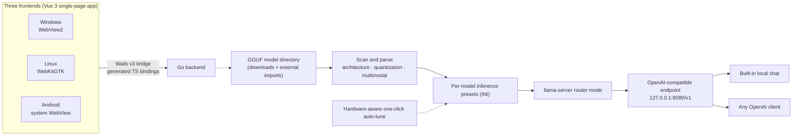

<div align="center">


# MyLlama (Android usability-fix fork)

**This fork fixes one thing: llama.cpp finishes downloading and extracting, and the app still says "llama.cpp not found" — always on Android, and on macOS / Linux whenever the tarball contains symlinks.**

It is still the same cross-platform local-LLM client built on [llama.cpp](https://github.com/ggml-org/llama.cpp): scan local GGUF files → configure inference parameters visually (or one-click auto-tune) → generate llama-server presets → serve one OpenAI-compatible endpoint for the built-in chat and any OpenAI client. Model downloads, local chat and live monitoring all happen inside the app, and nothing leaves your machine.

**📥 This fork's Android package:** [MyLlama-v0.5.3-fork.1-android-arm64.apk](https://github.com/msln1995/MyLlama/releases/download/v0.5.3-fork.1/MyLlama-v0.5.3-fork.1-android-arm64.apk) · [all releases](https://github.com/msln1995/MyLlama/releases)

The package id is `com.msln1995.myllama`, **different from upstream's `com.codeneow.llamadesktop`**: the two apps coexist and never overwrite each other, so installing this fork does not require uninstalling the official one.


Windows x64 · Android arm64 · Linux x64 · GPL-3.0

[简体中文](README.md) · English (this repository) · original project and official downloads: [CodeNeow/MyLlama](https://github.com/CodeNeow/MyLlama)

[](https://github.com/msln1995/MyLlama/actions)
[](https://github.com/msln1995/MyLlama/releases)
[](https://github.com/CodeNeow/MyLlama/pull/43)
[](LICENSE)
[](https://go.dev/dl/)
[](https://wails.io/)
[](https://vuejs.org/)

</div>

---

## 📌 What we changed

This repository is a fork of [CodeNeow/MyLlama](https://github.com/CodeNeow/MyLlama). **Upstream is not ours and only upstream publishes official releases** — this page describes our build only; for the original project's own description, follow the link above instead of looking for it here.

We touched exactly one path: **whether the app can actually find the runtime after it finishes downloading it**. The fix is submitted upstream as [PR #43](https://github.com/CodeNeow/MyLlama/pull/43); once it merges, the code divergence here disappears. The package id (item 4 below) is this fork's own decision and will never be submitted upstream.

1. **Asset selection**: on equal scores upstream kept the first candidate in GitHub API order, so Android / Linux arm64 usually landed on a `*-snapdragon` `cmake --install` package whose layout has no binary where the scanner looks. `pickBestAssetFor` now deprioritizes `-snapdragon` assets (−400), so the plain flat CPU package wins; snapdragon stays as a last resort.
2. **Directory layout**: upstream probed only the download directory itself and its first-level children. `findLlamaBinInDir` now also probes `bin/` inside each subdirectory (hard-bounded at two levels), and `detectAccel` / the CUDA-runtime probe walk the sibling `lib/`, so a `release/bin/<binary>` layout resolves too.
3. **Android launch**: the Android linker does not search the executable's own directory, so exporting only that directory was never enough. `androidLdEnv` now adds the sibling `lib/` to `LD_LIBRARY_PATH` (colon-separated).
4. **Its own package id**: `applicationId` / `namespace` became `com.msln1995.myllama` (upstream: `com.codeneow.llamadesktop`). This fork's debug-signed APK therefore **installs alongside the official app instead of colliding with it** — no more "uninstall first". The cost: the two apps have separate data directories, so config, the llama.cpp runtime and models do not carry over and must be downloaded again inside this fork. The Java sources stay in `com.wails.app` because the Wails v3 JNI export symbols are hard-coded to that package.
5. **Extraction no longer aborts on symlinks**: in the macOS / Linux tarballs `llama-server` sits after the symlink entries, and upstream aborted at the first symlink — which is why "installed" and "not found" were both true at once. `archive.go` now materializes in two passes: regular files first while link entries are collected, then symlinks / hardlinks are created, falling back to copying the target; copied bytes are charged to the total-size cap.
6. **Extraction hardening**: link targets must resolve inside the destination (the existing path-traversal rejection rule) plus a new `maxExtractTarLinks = 64` cap.

The matching focused tests live in the `core` package: asset-selection cases built from the real b11671 asset names in API order, detection cases for both directory layouts, and extraction cases for symlinks, hardlinks and the link-count cap.

## 🧭 What the app does

- **Self-managed runtime**: download the llama.cpp binaries and the CUDA runtime from the Home → Runtime tab, with resume support, or point the app at an existing llama.cpp directory.
- **Model management**: scan local GGUF and read real metadata (layers, attention heads, KV geometry, trained context, MoE expert split); search and download models from HF Mirror / Hugging Face / ModelScope.
- **One-click auto-tuning**: plan per-model inference parameters from the hardware snapshot plus a measured RAM-bandwidth calibration, with optional per-model llama-bench validation, and performance details such as n-gram speculative decoding, q8_0 KV quantization, a flash-attention switch and multi-GPU splitting.
- **One OpenAI-compatible endpoint**: generate llama-server presets and serve them (default `127.0.0.1:8080`); desktop runs router mode (lazy load, many models on one endpoint), Android runs direct mode (one resident model started from the chat page).
- **Built-in chat and monitoring**: sending a message in the chat page auto-starts the service and swaps in the selected model; the API page shows live token throughput and the service log console.
- **Local-first**: no telemetry, no cloud dependency, usable offline; light/dark themes, bilingual UI, and a phone tier that switches to bottom navigation with safe-area handling.

## 📥 Installing on Android

1. Download [MyLlama-v0.5.3-fork.1-android-arm64.apk](https://github.com/msln1995/MyLlama/releases/download/v0.5.3-fork.1/MyLlama-v0.5.3-fork.1-android-arm64.apk) (arm64, Android 5.0+; the [release page](https://github.com/msln1995/MyLlama/releases) lists every artifact).
2. Open it and allow "install unknown apps" when prompted. Because the package id differs, **it installs straight next to the official app** — nothing to uninstall.
3. Open the app → Home → Runtime tab → download llama.cpp. You now get the flat `...-bin-android-arm64.tar.gz`, and the component should read **installed** afterwards (that is the step this fork fixes).
4. Add a model directory or download one (the runtime must live in the app-private directory; Android's sandbox forbids executing binaries from shared storage, so there is no "place the files yourself" route).
5. Pick a model on the chat page and send a message — the service starts on its own.

## ⚠️ Fork-only limitations

- The APK is signed with the per-runner **debug keystore**, because Actions on a fork cannot read the repository secrets. Since the package id is our own, that only affects overwrite-installs *within* this package: upgrades from fork CI share the same debug key and install over each other normally.
- **Do not use the in-app "check for updates"**: `core/update.go` hard-codes the upstream release API, so it downloads an APK for the other package id. Upgrade manually from this repository's releases.
- The built-in tutorial (Docs page) also fetches its content from **upstream's `main`** — `core/remotedocs.go` hard-codes CodeNeow/MyLlama in both `docsRawBaseURL` and `docsJSDBaseURL` — so the on-device docs do not contain the fork notes above. This README is the description source for this fork.
- Two known gaps are deliberately left out of this change and are recorded in PR #43: `RuntimeSection.vue` hides both entry points when the status is `done`, and `GetLlamaCpp`'s result cache has no TTL and no re-scan binding.

---

## ✨ Why MyLlama

<table>
<tr>
<td width="50%" valign="top">

**🔒 Local-first · Privacy by design**<br/>
Models, conversations and inference data never leave your machine: no telemetry, no cloud dependency, fully usable offline — you decide where your data goes.

</td>
<td width="50%" valign="top">

**🎯 One-click smart tuning**<br/>
Reads real GGUF metrics (layers, attention heads, KV geometry, trained context, MoE expert split) and combines them with a hardware snapshot plus a measured RAM-bandwidth calibration to plan inference parameters per model.

</td>
</tr>
<tr>
<td width="50%" valign="top">

**⚡ Inference performance details**<br/>
n-gram speculative decoding with zero extra VRAM, q8_0 KV-cache quantization for longer contexts, a flash-attention toggle, multi-GPU split modes, Windows full-offload launch pins — validated per model with llama-bench.

</td>
<td width="50%" valign="top">

**🖥️ One experience, three platforms**<br/>
A single Go + Vue 3 codebase covers Windows / Linux / Android: the phone tier switches to bottom navigation with safe-area support, and themes, the zh / en UI and the built-in tutorial are consistent everywhere.

</td>
</tr>
<tr>
<td width="50%" valign="top">

**🔁 OpenAI-compatible ecosystem**<br/>
llama-server runs in router mode, serving every GGUF in your directory behind one OpenAI-compatible endpoint: models lazy-load on demand, unload in one click when idle, and any OpenAI client just plugs in.

</td>
<td width="50%" valign="top">

**📦 Model discovery and management**<br/>
Dual-source search across HF Mirror and ModelScope, batch downloads through a resumable queue that survives restarts, GGUF metadata parsing (architecture / quantization at a glance) and imported external directories.

</td>
</tr>
<tr>
<td width="50%" valign="top">

**📊 Visual monitoring**<br/>
Dual prompt-processing / generation tok/s metrics with a 60-second speed chart, live GPU / memory / CPU sampling, and a server-log console with cursor-based incremental refresh persisted to disk.

</td>
<td width="50%" valign="top">

**💤 Headless API mode**<br/>
(Windows) One toggle switches to background-only operation (tray + llama-server): GUI ↔ headless switches hand the server process over with zero downtime, and a loopback-only control plane serves health, status, logs and stop.

</td>
</tr>
</table>

<details>
<summary><b>📖 Table of Contents</b></summary>

- [📌 What we changed](#-what-we-changed)
- [🧭 What the app does](#-what-the-app-does)
- [📥 Installing on Android](#-installing-on-android)
- [⚠️ Fork-only limitations](#-fork-only-limitations)
- [✨ Why MyLlama](#-why-myllama)
- [🎨 UI and Design](#-ui-and-design)
- [🚀 Getting Started](#-getting-started)
  - [Windows](#windows) · [Android](#android) · [Linux](#linux) · [macOS](#macos)
  - [First Run in Three Steps](#first-run-in-three-steps)
- [🧠 One-Click Auto-Tune](#-one-click-auto-tune)
- [🔌 API Access](#-api-access)
- [🔧 Configuration](#-configuration)
- [🧱 Architecture](#-architecture)
- [🔨 Build from Source](#-build-from-source)
- [❓ FAQ](#-faq)
- [📄 License and Acknowledgements](#-license-and-acknowledgements)

</details>

---

## 🎨 UI and Design

> The images below are renders of the UI design mockups (desktop 1280×800, phone 390×844, light and dark themes; source drafts in [docs/branding](docs/branding)). They showcase layout and visual style; the shipped UI on each platform is the reference.

**Desktop · Light theme**

<table>
<tr>
<td width="50%" align="center">

<br/>
<i>Home · system info & quick start</i>

</td>
<td width="50%" align="center">

<br/>
<i>Local chat · streaming with deep-thinking blocks</i>

</td>
</tr>
<tr>
<td width="50%" align="center">

<br/>
<i>Models · downloads & my models</i>

</td>
<td width="50%" align="center">

<br/>
<i>API router · service control & live monitoring</i>

</td>
</tr>
</table>

**Desktop · Dark theme**

<table>
<tr>
<td width="50%" align="center">

<br/>
<i>Home · system info (dark theme)</i>

</td>
<td width="50%" align="center">

<br/>
<i>Local chat (dark theme)</i>

</td>
</tr>
<tr>
<td width="50%" align="center">

<br/>
<i>Models (dark theme)</i>

</td>
<td width="50%" align="center">

<br/>
<i>API router (dark theme)</i>

</td>
</tr>
</table>

**Android · Direct mode**

<table>
<tr>
<td width="33%" align="center">

<br/>
<i>Home</i>

</td>
<td width="33%" align="center">

<br/>
<i>Chat</i>

</td>
<td width="33%" align="center">

<br/>
<i>Models</i>

</td>
</tr>
<tr>
<td width="33%" align="center">

<br/>
<i>API router</i>

</td>
<td width="33%" align="center">

<br/>
<i>Preferences</i>

</td>
<td width="33%" align="center">

<br/>
<i>Task dock · the floating capsule</i>

</td>
</tr>
</table>

**Pages at a glance**

| Page | Purpose |
| --- | --- |
| **Home** | "System Info" detects CPU / memory / GPU / CUDA with live sampling (including Blackwell compatibility verdicts); "Runtime Environment" one-click downloads llama.cpp or points at a custom directory, with a smart landing tab |
| **Chat** | Streaming local conversations: Markdown rendering, foldable deep-thinking blocks, image attachments, generation presets (precision / balanced / creative / random + custom) and per-session sampling; sending auto-starts the service |
| **Models** | "Download": tri-source search (HF Mirror / Hugging Face / ModelScope) with a file-level resumable queue; "My Models": scan & parse (architecture / quantization / multimodal detection), one-click auto-tune and per-model settings |
| **API** | Start / stop the service, dual tok/s metrics and the speed chart, cursor-incremental server log, loaded-model management with one-click unload; port / max-concurrency / prompt-cache options |
| **Settings** | Theme / language (zh · en · auto) / download source / directories / access scope & serving GPU / Windows tray / API-route mode / update check; the "Help & Tutorial" card opens the built-in bilingual tutorial (updated online) |

---

## 🚀 Getting Started

### Windows

Grab `MyLlama-setup-*-windows-amd64.exe` from the [latest release](https://github.com/CodeNeow/MyLlama/releases/latest) and double-click to install (the installer embeds the WebView2 Runtime bootstrapper and installs it automatically if missing). The app updates itself, so later versions need no manual reinstall.

Requirements: Windows 10 or later (x64).

### Android

For this fork, see the "📥 Installing on Android" section above: download `MyLlama-v0.5.3-fork.1-android-arm64.apk` from **this repository's** releases. The package id `com.msln1995.myllama` differs from upstream's `com.codeneow.llamadesktop`, so it coexists with the official app and installs without uninstalling anything. The original build (`com.codeneow.llamadesktop`) still comes from [CodeNeow/MyLlama Releases](https://github.com/CodeNeow/MyLlama/releases/latest). Note: do not use "Preferences → Check for Updates" in this fork — that API only ever fetches an APK built for the other package id; come back to this repository's releases and install manually (fork CI debug-signed builds do overwrite-install each other).

### Linux

Releases ship `.deb` packages for Ubuntu 22.04 / 24.04: download `myllama_*_amd64.deb` and install it (`sudo apt install ./myllama_*_amd64.deb`); the GTK / WebKit runtime libraries are resolved automatically through package dependencies. Other distributions can [build from source](#-build-from-source).

### macOS

No prebuilt distribution for now; the codebase still builds from source (Apple Silicon uses Metal acceleration). See [Build from Source](#-build-from-source).

### First Run in Three Steps

1. **Install the runtime** — on **Home**, in the "Runtime Environment" tab, click "Download llama.cpp" to fetch the latest release from GitHub (resumable), or point the app at an existing llama.cpp directory.
2. **Get a model** — on the **Models** page's "Download" tab, search HF Mirror / Hugging Face / ModelScope and download a GGUF file into the models directory (`LLM-Models/` by default); progress shows up in the floating task dock at the bottom-right corner.
3. **Chat** — open **Chat**, pick the model, and just send a message — sending auto-starts the local service and loads the selected model on demand, no manual start needed.

> Next step: to connect other OpenAI-compatible clients or manage the service by hand, click "Start Server" on the **API** page (default `127.0.0.1:8080`); see [API Access](#-api-access).

---

## 🧠 One-Click Auto-Tune

"How should this model run on my machine?" — one click on **Auto-Tune** in the Model Settings page, and MyLlama answers with real data.

**Input: measured + parsed**

| Input | Source |
| --- | --- |
| Layer count, attention heads, KV geometry, trained context, MoE expert split | GGUF header parsing |
| GPU vendor & VRAM, RAM, CPU cores; on Android the SoC identity and big.LITTLE performance-core count | Hardware snapshot |
| All-core streaming-read RAM bandwidth (cached per hardware fingerprint, rejected across machines) | Bandwidth calibration |

**Output: an executable inference plan**

- Automatically picks among **full GPU offload / MoE `--cpu-moe` split / partial offload / CPU-only**: when a full offload leaves the context cramped, it flips to "cpu-moe + large context";
- Plans the context ladder and KV-cache quantization (q8_0) to fit the longest context into your VRAM budget;
- Results fill the settings form in real time for further tweaks; "Deep benchmark" runs the bundled llama-bench for a real decode-speed verdict on the saved plan.

---

## 🔌 API Access

Once the service is running, any OpenAI-compatible client can connect:

```bash
OPENAI_BASE_URL="http://127.0.0.1:8080/v1"
OPENAI_API_KEY="sk-any-placeholder"   # no auth by default; an optional API key can be set in Preferences
```

Set `model` to the name shown in the UI (copy it from the model tags on the API page or the "My Models" tab) — llama-server loads and unloads models on demand, and in-memory models can also be unloaded from the task dock. Quick smoke test:

```bash
curl http://127.0.0.1:8080/v1/chat/completions \
  -H "Content-Type: application/json" \
  -d '{"model":"model-name","messages":[{"role":"user","content":"hello"}]}'
```

In Windows headless (API-route) mode the endpoint stays available, plus a loopback-only control plane at `127.0.0.1:1900` (`/health`, `/status`, `/logs`, `/stop`, optional token auth) for scripts and external tools to manage the background service.

---

## 🔧 Configuration

Runtime settings are persisted to `myllama-config.json`, whose location differs per platform (resolved centrally in `core/paths.go`):

- **Windows**: the process working directory (typically the install directory `%PROGRAMFILES64%\MyLlama`);
- **Linux**: the app-data directory `~/.config/myllama/`;
- **macOS** (source builds): `~/Library/Application Support/myllama/`;
- **Android**: the app-private data directory, isolated per package id — this fork lives in `/data/data/com.msln1995.myllama/files/`, upstream in `/data/data/com.codeneow.llamadesktop/files/`; each keeps its own config, llama.cpp runtime and models, and neither is visible to the other.

Legacy data migrates automatically: older `llama-desktop-config.json` / `llama-gui-config.json` files are renamed on first launch (config, model library and llama.cpp runtime all carry over); the Windows installer also migrates a legacy Llama Desktop install's data into the new install directory and silently uninstalls the legacy entry.

Key fields:

| Field | Meaning | Default |
| --- | --- | --- |
| `theme` | UI theme: `light` / `dark` | `light` |
| `language` | UI language: `zh` / `en` / `auto` (auto follows the OS locale) | `auto` |
| `downloadSource` | Default model source: `hf` (HF Mirror) / `huggingface` (official) / `modelscope` | `hf` |
| `trayEnabled` | System tray, closing the window minimizes to tray (Windows) | `true` |
| `sidebarCollapsed` | Whether the sidebar starts collapsed | `true` |
| `apiRouteMode` | API-route (headless) mode (Windows): on the next start the app runs as tray + llama-server only, no GUI | `false` |
| `serverConfig` | `accessMode` (`local` / `lan`), `host`, `port`, `maxModels`, `cacheRam` (MiB), `apiKey` (optional auth; the key is stored in the local config file in plaintext — single-user machine — and delivered to llama-server via the `LLAMA_API_KEY` env var, never the command line), `deviceId` (inference GPU pin) | `127.0.0.1:8080`, `maxModels` 1, `cacheRam` 8192, no auth, GPU auto |

Also stored: `llamaCppDownloadDir` / `modelDownloadDir` (download paths) and `llamaCppDir` / `modelDir` (imported external directories), `modelConfigs` (per-model inference parameters), `downloadTasks` (the download queue, recovered on restart) and `onboardingDismissed` (whether the home quick-start checklist was closed).

---

## 🧱 Architecture



The frontend is a Vue 3 single-page app that talks to the Go backend through the Wails v3 bridge (TypeScript bindings generated at build time); the same frontend renders inside WebView2 on Windows, WebKitGTK on Linux and the system WebView on Android. The backend scans the model directories, parses GGUF metadata, generates per-model inference presets and launches llama-server. Running in router mode, llama-server serves every GGUF in the directory behind one OpenAI-compatible endpoint, loading and unloading models on demand — the built-in chat and any OpenAI client connect to that same endpoint (Android runs direct mode: one resident model, started from the Chat page).

---

## 🔨 Build from Source

- [Git](https://git-scm.com/), [Go](https://go.dev/dl/) 1.25+, [Node.js](https://nodejs.org/) 18+
- Wails v3 CLI (matching the v3 version in go.mod):

  ```bash
  go install github.com/wailsapp/wails/v3/cmd/wails3@v3.0.0-beta.16
  ```

- Platform dependencies:
  - **Windows**: WebView2 Runtime (usually preinstalled on Windows 10/11);
  - **Linux**: GTK4 and WebKitGTK 6.0 development packages, e.g. `sudo apt install libgtk-4-dev libwebkitgtk-6.0-dev pkg-config` (Debian/Ubuntu; the released `.deb` packages are built with the `-tags gtk3` variant, i.e. GTK3 + WebKit2GTK 4.1);
  - **Android**: JDK 17 plus the Android SDK / NDK (`sdkmanager "ndk;26.3.11579264" "platforms;android-35"`); see the android section of [Taskfile.yml](Taskfile.yml) and the [CI configuration](.github/workflows/ci.yml);
  - **macOS**: no prebuilt distribution; source builds work (Apple Silicon uses Metal).

Clone and build:

```bash
git clone https://github.com/CodeNeow/MyLlama.git
cd MyLlama
wails3 task build            # Windows / Linux / macOS desktop build
wails3 task android:package  # Android arm64 APK (build the frontend first; output in build/bin/)
```

Dev mode (Go backend + Vite frontend with hot reload, dev server pinned to `http://localhost:5173`):

```bash
wails3 task dev
```

Combined quality gate:

```bash
powershell -NoProfile -ExecutionPolicy Bypass -File .\scripts\check.ps1     # Windows
make check                                                                  # POSIX
```

The gate runs `go build` / `go test` / `gofmt` / `golangci-lint` on the backend and `npm run build` (vue-tsc + vite) on the frontend; the PowerShell script also runs the vitest suite (`npm test`). Backend tests live in `core/*_test.go` (standard library `testing`, including service-chain E2E against a real llama-server), frontend tests in `frontend/src/__tests__/`. See [AGENTS.md](AGENTS.md) and [CONTRIBUTING.md](CONTRIBUTING.md) for conventions, commit format and the collaboration workflow.

---

## ❓ FAQ

**The app reports it is already running at startup.**
The app enforces a single-instance mutex, so duplicate launches are blocked (the window also covers retries inside the headless → GUI handover window). Close any running MyLlama first (including tray-only background instances), then start it again.

**`wails3 task dev` reports the port is already in use.**
The Vite dev server binds `localhost:5173` (`VITE_PORT` in the Taskfile, overridable via the `WAILS_VITE_PORT` environment variable). End the process occupying it and retry.

**"Start Server" on the API page fails with "no models found".**
Startup scans the models directory and generates presets first, so an empty directory is an error. Put GGUF files into `LLM-Models/` (check the "My Models" tab of the Models page) and try again. Also confirm llama.cpp is installed, as shown in the "Runtime Environment" tab of the Home page.

**API calls fail with `model not found`.**
The `model` field must match the name shown in the UI exactly (the service matches case-sensitively). Copy-paste from the API page model tags or the "My Models" tab of the Models page instead of typing it by hand.

**Every backend call fails when running the frontend with `npm run dev` standalone.**
The frontend calls the Go backend through Wails v3 bindings generated at build time; Vite without `wails3 task dev` has no bridge to the backend, so calls fail at the request stage — this is expected. Use `wails3 task dev` to debug the UI with the backend attached (or `npm run dev:mock` for a browser-only preview backed by the in-repo mock).

**The Linux source build fails with missing GTK / WebKit dependencies.**
The Wails v3 Linux build goes through cgo: the default path needs the GTK4 and WebKitGTK 6.0 development packages (`libgtk-4-dev`, `libwebkitgtk-6.0-dev`), while the `-tags gtk3` variant needs `libgtk-3-dev` and `libwebkit2gtk-4.1-dev`. Install the packages matching your build variant — plus `pkg-config` — via your package manager and build again.

**Android install or in-app update fails.**
Installing the APK requires allowing "install unknown apps". This fork's package id is `com.msln1995.myllama` and upstream's is `com.codeneow.llamadesktop`, so they are two independent apps that never overwrite each other — installing this fork does not require uninstalling the official one. "Overwrite-install needs one signature" only applies *inside a single package id*: every artifact here comes from fork CI's debug keystore, so upgrades overwrite cleanly, while pushing an APK signed with a different key into the same package id is what fails (and forces an uninstall). Do not use the in-app "check for updates" in this fork: `core/update.go` hard-codes the upstream release API, so it only ever fetches an APK for the other package id. The app is sideload-only (not on any app store), and this fork's updates always come from this repository's releases.

**The llama.cpp download is slow or fails.**
The download source is GitHub Releases and supports pause / resume with range requests. On desktop you can fetch the archive for your platform manually, extract it, and point the app at it via Home → Runtime tab → custom directory — **but Android has no such route**: the runtime must live in the app-private directory `/data/data/<package>/files/llama-cpp`, which a file manager cannot write to, and Android will not execute a binary from shared storage anyway. On Android use the in-app download button.

**llama.cpp finished downloading and extracting, yet the app still says it cannot find it.**
This is exactly what this fork fixes. Upstream hits it in three situations: (1) Android / Linux arm64 selected a `*-snapdragon` cmake-install package; (2) the package uses the `llama-bXXXX/bin/` + `lib/` layout while the scanner only looked at flat directories; (3) on macOS / Linux the tarball contains symlink entries and upstream aborted extraction at the first one, while `llama-server` sits later in the archive and therefore never landed. All three are fixed here (see "What we changed" above). If it still reports missing, check whether the Runtime tab shows the component installed: `GetLlamaCpp`'s result is cached for the process with no TTL and no re-scan, so restart the app; and note that `RuntimeSection.vue` collapses both entry points once the status is `done`. Those two gaps are recorded in [PR #43](https://github.com/CodeNeow/MyLlama/pull/43) and remain unfixed.

---

## 📄 License and Acknowledgements

Copyright © 2026 [CodeNeow](https://github.com/CodeNeow/MyLlama)

This project is licensed under the [GNU General Public License v3](LICENSE).

MyLlama stands on the shoulders of these open-source projects — thank you:

- [llama.cpp](https://github.com/ggml-org/llama.cpp) (the ggml / GGUF ecosystem) — the high-performance local inference engine;
- [Wails](https://wails.io/) — the framework for building cross-platform desktop / mobile apps with Go + web technologies;
- [Vue](https://vuejs.org/) and [Vite](https://vitejs.dev/) — the frontend framework and toolchain;
- [hf-mirror.com](https://hf-mirror.com), [Hugging Face](https://huggingface.co) and [ModelScope](https://modelscope.cn) — the open model ecosystem.

Third-party model files remain the property of their respective authors; follow each model's own license when downloading and using them.
